<picture>
  <source media="(prefers-color-scheme: dark)" srcset="assets/banner-dark.svg">
  <source media="(prefers-color-scheme: light)" srcset="assets/banner-light.svg">
  
</picture>

  
  
  

Hi, I'm Yazid. I write web apps with Laravel and Vue 3 (TypeScript), and mobile apps with React Native.

I'm in my third year of Software Engineering at IFRI, Université d'Abomey-Calavi. I've done two internships so far: full-stack at **Waouh Monde**, where our team built an app to manage a vehicle sales lot, and mobile at **Brillio Africa**, where I worked on the React Native side of an offline-first app that syncs with its server.

I also take freelance work. Mostly web apps, Mobile Money payments with FedaPay, and real-time features.

🇫🇷 En français

 

Salut, moi c'est Yazid. Je développe des applications web avec Laravel et Vue 3 (TypeScript), et des applications mobiles avec React Native.

Je suis en troisième année de Génie Logiciel à l'IFRI, Université d'Abomey-Calavi. J'ai fait deux stages : en fullstack chez **Waouh Monde**, où on a construit en équipe une application de gestion d'un parc de vente de véhicules, et en mobile chez **Brillio Africa**, sur la partie React Native d'une application offline-first synchronisée avec son serveur.

Je prends aussi des missions freelance : applications web, paiements Mobile Money avec FedaPay, fonctionnalités temps réel.

 

## Tools I use

  

Also: Sanctum and Reverb on the Laravel side, FedaPay for payments, Railway and Hostinger for hosting. Learning Python for data.

 

## QuizZy

**Real-time multiplayer quiz.** Players join a room with a code, everyone gets the same question at the same moment, and the leaderboard updates as answers come in. The host decides when to move on.

How it works: the host's actions are broadcast over WebSockets with Laravel Reverb and each client updates its own screen. Scores are calculated on the server, so a tampered client can't push itself up the board. If someone drops and reconnects, they land back on the current state of the room.

I've reused this setup for every real-time feature I've built since.

**[Try it live →](https://quiz-zy-ebon.vercel.app/)**

<!-- When assets/quizzy.gif exists, put this line right under "## QuizZy":

-->

 

## Right now

- Third year of Software Engineering at IFRI
- Building **Testify**, a platform to evaluate job candidates
- Building **MediAlert**, a mobile alert app

Last updated October 2026

 

<picture>
  <source media="(prefers-color-scheme: dark)" srcset="https://raw.githubusercontent.com/Yazid-006/Yazid-006/output/github-contribution-grid-snake-dark.svg">
  <source media="(prefers-color-scheme: light)" srcset="https://raw.githubusercontent.com/Yazid-006/Yazid-006/output/github-contribution-grid-snake.svg">
  
</picture>

 

## Contact

Got a project or a role in mind? Email works best: **[yarouyazid9@gmail.com](mailto:yarouyazid9@gmail.com)**. I'm also on **[LinkedIn](https://www.linkedin.com/in/yazid-yarou-47330a350)**.
