  

I'm **YAROU Yazid**, a Software Engineering student at the Institut de Formation et de Recherche en Informatique (IFRI). I'm passionate about everything related to Artificial Intelligence and data, and I like to understand a problem before trying to solve it. That's why I build websites and apps I would want to use myself. Every project is a chance for me to learn, sharpen my skills and fix a real problem.

<b>Version française</b>

 

Je me nomme **YAROU YAZID**, étudiant en Génie Logiciel à l'Institut de Formation et de Recherche en Informatique. Passionné par tout ce qui touche à l'Intelligence Artificielle et aux données, j'aime comprendre les problèmes avant de chercher à les résoudre. Ainsi je développe des sites et des apps que j'aurais moi-même envie d'utiliser. Chaque projet est pour moi une occasion d'apprendre, d'améliorer mes compétences et de pallier un problème.

 

##  About

Two internships so far: full-stack at **Waouh Monde**, where our team built an app to manage a vehicle sales lot, and mobile at **Brillio Africa**, on the React Native side of an offline-first app that syncs with its server.

 

##  Stack

 

##  Activity

 

##  Contact

  
  &nbsp;
  

  

